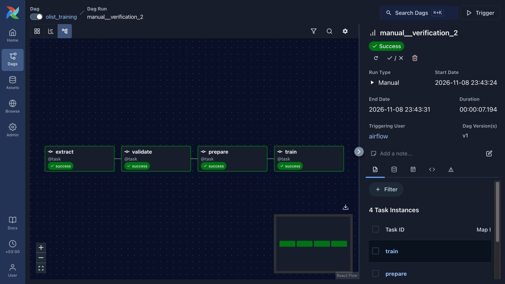
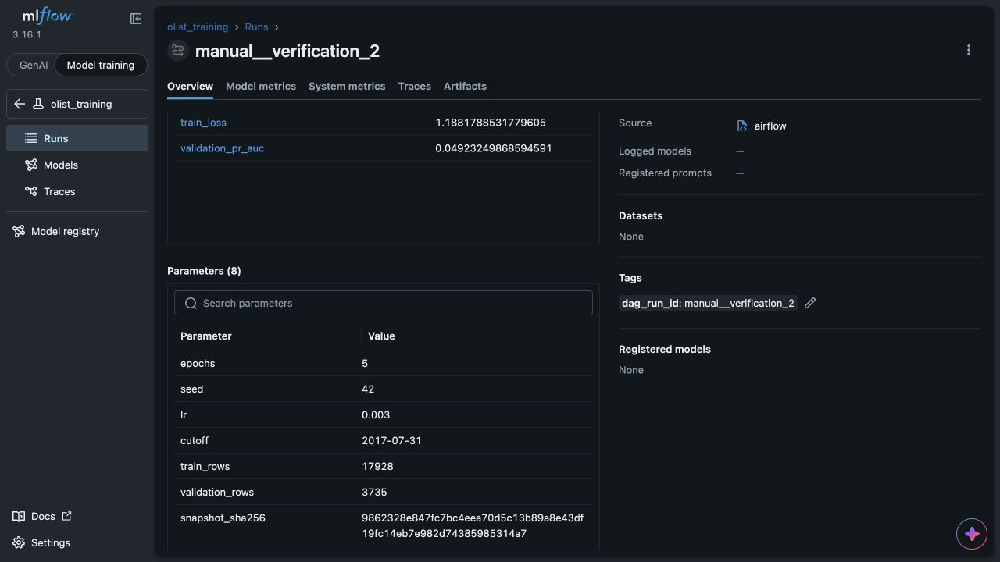

# Локальный ML пайплайн Olist

Проект обучает выданную CPU-модель опоздания доставки через PostgreSQL → Airflow → MLflow. DAG `olist_training` содержит четыре отдельные задачи: `extract → validate → prepare → train`.

Данные и алгоритм поставлены в стартовом наборе. `data/`, `src/olist_model.py` и `src/check_model.py` сохранены без изменений. Полные требования находятся в [ASSIGNMENT.md](ASSIGNMENT.md).

## Запуск из чистого клона

Нужны Git и работающий Docker с Compose, поддерживающим `docker compose`. На macOS подойдёт Docker Desktop или Colima. Рекомендуется выделить Docker не менее 4 ГБ RAM и 2 CPU; первая сборка скачивает образы и Python-зависимости.

```bash
git clone https://github.com/vitalykab/olist-ml-pipeline.git
cd olist-ml-pipeline
cp .env.example .env
docker compose up -d --build
docker compose ps
```

Для приватного репозитория нужен доступ GitHub. Дождитесь состояния `healthy` у трёх сервисов. При первом старте PostgreSQL сам загружает выданные данные; при перезапуске существующий volume используется повторно.

Интерфейсы доступны только на компьютере:

- Airflow: http://127.0.0.1:8080 — учебный standalone, без пароля.
- MLflow: http://127.0.0.1:5050 — эксперимент `olist_training`.

Если порты заняты, задайте `AIRFLOW_PORT` и `MLFLOW_PORT` в `.env`, затем повторите `docker compose up -d --build`.

Сначала включите и запустите `example_one_task` в Airflow. Затем включите `olist_training` и нажмите Trigger. Дождитесь успеха всех четырёх задач. Новый эксперимент появится в MLflow. Для повторной проверки нажмите Trigger ещё раз: создастся отдельный run, строки не будут накапливаться.

Альтернатива через CLI:

```bash
docker compose exec -T airflow airflow dags unpause olist_training
docker compose exec -T airflow airflow dags trigger olist_training
```

## Проверка данных и подключений

```bash
docker compose exec -T source psql -U olist -d olist -c 'SELECT count(*), count(DISTINCT order_id) FROM orders;'
docker compose exec -T airflow python -c "import urllib.request; print(urllib.request.urlopen('http://mlflow:5000/health', timeout=5).status)"
```

Ожидается 21 663 строки и столько же уникальных заказов; MLflow должен ответить HTTP 200.

Внутри Airflow используется `MLFLOW_TRACKING_URI=http://mlflow:5000`: `localhost` внутри контейнера не является компьютером или соседним контейнером. PostgreSQL доступен через `DATABASE_URL`, рабочие файлы — через `OLIST_WORKDIR=/opt/olist/work`.

## Этапы и восстановление

| Этап | Результат |
|---|---|
| `extract` | Упорядоченная выгрузка `public.orders` в обычный UTF-8 `snapshot.csv`; абсолютный путь строкой |
| `validate` | Проверка 13 столбцов, непустых данных, уникальных непустых ID, чисел без NaN/Inf, меток 0/1 и корректных дат; возвращает путь |
| `prepare` | Готовая `split_by_time`, файлы train/validation и короткий словарь путей, размеров и SHA256 |
| `train` | Готовая `fit_model`, параметры и метрики по эпохам в MLflow, полный артефакт `model`, возвращаемый MLflow `run_id` |

`validate(snapshot)` только читает файл: не создаёт каталоги, не записывает отчёты, не использует сеть или БД. Некорректный вход вызывает исключение и блокирует дальнейшие задачи.

Каждому Airflow run соответствует каталог `/opt/olist/work/<SHA256 Airflow run_id>/`. Запись CSV атомарна; повтор `extract` заменяет файл. Через XCom идут только пути и метаданные. Снимки и выборки остаются в volume `work`, поэтому повторный `train` может использовать уже подготовленные данные. Перед обучением проверяются хеши исходного снимка и обеих выборок.

Расписание: понедельник, 03:00 UTC (06:00 МСК); `catchup=False`, `max_active_runs=1`. У `extract` две повторные попытки с паузой 30 секунд. `validate` не повторяется. У `validate`, `prepare`, `train` — `all_success`. Таймауты: extract 5 минут, validate 2, prepare 5, train 15.

## Эксперимент и прогноз

Значения по умолчанию: 5 эпох, seed 42, learning rate 0.003, cutoff `2017-07-31`. Их можно задать через `.env` (`OLIST_EPOCHS`, `OLIST_SEED`, `OLIST_LR`, `OLIST_CUTOFF`) и пересоздать сервис через `docker compose up -d`.

Train содержит покупки до cutoff, validation — начиная с cutoff. При стандартной границе размеры — 17 928 и 3 735. Преобразования обучаются только на train внутри выданной модели. `validation_pr_auc` — average precision; sigmoid scores не являются откалиброванными вероятностями.

MLflow сохраняет `epochs`, `seed`, `lr`, `cutoff`, `train_rows`, `validation_rows`, `snapshot_sha256`, а также `snapshot_path`. Тег `dag_run_id` точно совпадает с Airflow run ID. Артефакт `dataset.json` содержит пути и хеши; хеш исходного снимка считается по байтам CSV из PostgreSQL, а не по `.csv.gz` или подготовленным выборкам.

В MLflow откройте успешный run и скопируйте его Run ID:

```bash
docker compose exec -T airflow python -m check_model --run-id RUN_ID
```

Вместо `RUN_ID` подставляется 32-символьный идентификатор MLflow, не Airflow. Команда скачивает `runs:/RUN_ID/model`, загружает `weights.pt` и `preprocessing.json` и выводит JSON с пятью прогнозами. В чистом окружении используйте ID созданного там эксперимента.

## Проверки ошибок и сохранности

Для проверки плохих данных временно измените `extract`, чтобы после выгрузки он создал отдельную копию CSV с повторным `order_id` и вернул путь к копии. Запустите отдельный DAG. Ожидается: extract — success, validate — failed, prepare/train — upstream_failed. Восстановите исходный код; поставленный `data/` не изменяйте.

Для проверки восстановления временно добавьте `raise RuntimeError('intentional training failure')` в начало `train` и запустите отдельный DAG. Дождитесь ошибки train, восстановите код, затем откройте именно эту задачу именно этого запуска и выполните Clear. Не выбирайте upstream, downstream, прошлые или будущие запуски. Успешные extract/validate/prepare должны сохранить прежние попытки и время выполнения; train завершится успешно.

Для проверки постоянного хранения запомните успешный MLflow run ID и его прогнозы, затем выполните:

```bash
docker compose restart
docker compose up -d --force-recreate --no-deps mlflow
docker compose ps
# После healthy у MLflow:
docker compose exec -T airflow python -m check_model --run-id RUN_ID
```

Должны сохраниться эксперимент, метрики, модель и прежние прогнозы. SQLite и артефакты MLflow хранятся вместе в volume `mlflow-data`. `docker compose down -v` удаляет volumes — не используйте его для этой проверки.

## Автоматические тесты и диагностика

Контрактные тесты запускаются в окружении Airflow, включая проверку реального чтения PostgreSQL:

```bash
docker compose cp tests airflow:/tmp/olist-tests
docker compose exec -T airflow python -m unittest discover -s /tmp/olist-tests -v
```

Для диагностики:

```bash
docker compose logs --tail=100 airflow
docker compose logs --tail=100 mlflow
docker compose exec -T airflow airflow dags list-import-errors
```

Правки `src/` и `dags/` доступны через mounts; для изменения зависимостей пересоберите образ. Для обычной остановки используйте `docker compose stop`, для запуска — `docker compose up -d`.

## Результаты выполненной проверки

Проверено 8 ноября 2026 года на macOS arm64, в Linux VM Colima с 2 CPU и 4 ГБ RAM. Все три сервиса стали healthy. Исходные данные и выданные модули модели совпали по SHA256 с исходным набором.

| Проверка | Фактический результат |
|---|---|
| Контрактные тесты | 14 тестов прошли в контейнере, включая PostgreSQL и DAG |
| `example_one_task` | Success |
| `manual__verification_1` | Все четыре задачи success; MLflow `dfc17aacebc94bc7af66ed67215b0c8a` |
| `manual__verification_2` | Все четыре задачи success; MLflow `5e2befaeb4d44ac8bbc674d35066f241` |
| Повторный запуск | Снова 21 663 строки; train 17 928, validation 3 735; хеш снимка не изменился |
| `manual__verification_bad_data` | validate — failed; prepare/train — upstream_failed с `try_number=0` |
| `manual__verification_clear` | train: failed на попытке 1 → success на попытке 2; остальные задачи сохранили попытку 1 и прежние start/end timestamps |
| Restart и force-recreate MLflow | Сохранились параметры, полная история метрик и модель; пять прогнозов совпали точно |
| Чистый локальный Git-клон и новые volumes | `manual__clean_clone` — success; новый MLflow run `db40e56b17654ed69b208950a6bfd9d8`; метрики и пять прогнозов совпали |

Clear выполнен через официальный REST API Airflow с `task_ids=["train"]` и точным `dag_run_id`; upstream/downstream/past/future были выключены. После восстановления обучения создан MLflow run `5829a2a37c994028b4b74a917adb85aa`. Временные ошибки из кода убраны. Запуск с плохими данными намеренно остаётся failed в истории — это результат проверки, а не неисправность рабочего DAG.

При первом включении Airflow также выполнил один последний завершённый недельный интервал (`scheduled__2026-11-02T03:00:00+00:00`). `catchup=False` не создаёт всю историю пропущенных интервалов, но допускает этот последний плановый запуск.

Итоговые метрики для стандартных параметров:

- `train_loss = 1.1881788531779605`;
- `validation_pr_auc = 0.04923249868594591`;
- обе метрики записаны на шагах 1–5; качество алгоритма не оптимизировалось.

SHA256 исходного CSV extract:

```text
9862328e847fc7bc4eea70d5c13b89a8e43df19fc14eb7e982d74385985314a7
```

Команда, выполненная до и после пересоздания MLflow:

```bash
docker compose exec -T airflow python -m check_model --run-id 5e2befaeb4d44ac8bbc674d35066f241
```

Результат:

```json
{"run_id":"5e2befaeb4d44ac8bbc674d35066f241","rows":5,"probabilities":[0.7106074094772339,0.5012513399124146,0.2709561884403229,0.1435118466615677,0.22757172584533691]}
```

Эти ID относятся к окружению автора. После клонирования и своего обучения нужно скопировать новый ID из собственного MLflow.





## Локальное окружение автора

На компьютере автора установлен Docker CLI с Compose и Buildx, а Linux engine работает через профиль Colima `olist` (2 CPU, 4 ГБ RAM). Основной Compose-проект — `olist-homework`; он оставлен работающим. Отдельный проект проверки чистого клона `olist-clean-check` остановлен. Volumes основного окружения сохранены.

После перезагрузки компьютера при необходимости выполните:

```bash
colima start --profile olist
docker context use colima-olist
# Из каталога проекта:
docker compose up -d
```

Для освобождения ресурсов можно остановить сервисы командой `docker compose stop`, затем VM командой `colima stop --profile olist`. На компьютере проверяющего эти команды Colima не нужны, если Docker уже работает другим способом.

## Сдача и лицензия

Сдаются ссылка на репозиторий и SHA финального коммита (`git rev-parse HEAD`), README и два скриншота: успешный DAG и MLflow run с параметрами и метриками.

Выданные данные остаются в Git. `.env`, рабочие CSV, модели и логи исключены; результаты в Docker volumes не входят в репозиторий. Источник и условия использования данных — [data/README.md](data/README.md) и [data/LICENSE.md](data/LICENSE.md), CC BY-NC-SA 4.0.
